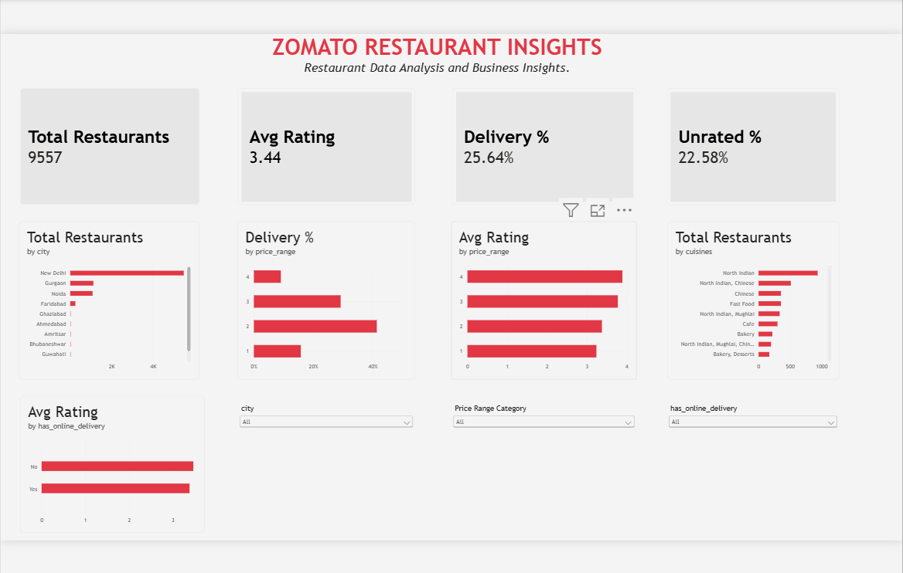

# Zomato Restaurant Data Analysis

Analysis of Zomato restaurant data to understand how ratings, pricing, cuisines and online delivery vary across cities, using MySQL, Python and Power BI.

## Dataset
- Source: Zomato Restaurants Data (Kaggle)
- Size: 9,551 restaurant records, 21 columns
- Fields include city, cuisines, price range, aggregate rating, votes, online delivery and table booking

## Tools Used
| Tool | Purpose |
|------|---------|
| MySQL | Storing the data and running 26 SQL analyses |
| Python (pandas, Matplotlib) | Data cleaning and 10 exploratory charts |
| Jupyter Notebook | Python analysis environment |
| Power BI | Interactive dashboard |

## Project Workflow
1. Loaded the dataset into MySQL
2. Ran 26 SQL analyses (GROUP BY, CASE WHEN, aggregate functions)
3. Cleaned the data in pandas, including 9 missing cuisine values
4. Created 10 exploratory charts
5. Built a Power BI dashboard with KPI cards, charts and slicers

## Key Findings
- The dataset has 9,551 restaurants; 2,148 (22.5%) are unrated and were excluded from rating averages
- The average rating among rated restaurants is 3.44 out of 5
- About 25.7% of restaurants offer online delivery
- Delivery availability varies by price range:

| Price Range | Restaurants | With Online Delivery | Share |
|-------------|-------------|----------------------|-------|
| 1 | 4,444 | 701 | 15.8% |
| 2 | 3,113 | 1,286 | 41.3% |
| 3 | 1,408 | 411 | 29.2% |
| 4 | 586 | 53 | 9.0% |

- Delivery is most common in mid-priced restaurants (range 2) and least common in premium ones (range 4)
- New Delhi has the highest restaurant count in the dataset

## Data Limitations
- Unrated restaurants (rating 0) are excluded from average ratings
- Cost values are in different currencies, so cost is not compared across countries
- The results show associations, not causes

## Dashboard

## Repository Files
- `zomato_clean.csv`: cleaned dataset
- `zomato_analysis.sql`: SQL queries
- `Zomato_Analysis.ipynb`: Python analysis notebook
- `zomato_dashboard.pbix`: Power BI dashboard
- `dashboard.png`: dashboard screenshot

## Conclusion
This project covers the full analytics process: storing data, querying it with SQL, cleaning and exploring it in Python, and presenting the results in a dashboard.
